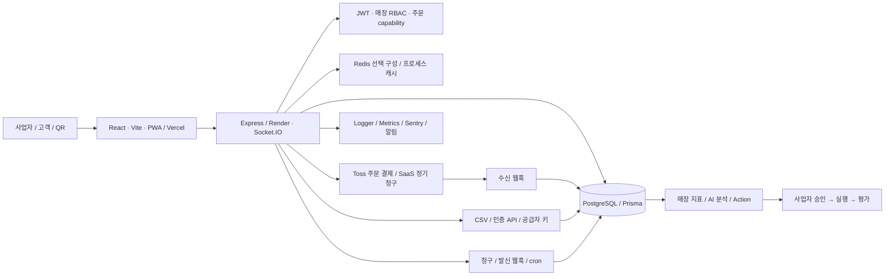

# WeMarket Production Readiness Audit

감사일: 2026-10-08 KST · 기준 저장소: `D:\wemarket-toss\250105`

기준 HEAD: `7d0c93fd69454bf46755038bb1e8a1180ffdb476` (main). 감사 대상은 **현재 작업 트리**이며 HEAD와 다르다. 본 감사에서는 애플리케이션 코드·DB·운영 설정을 변경하지 않았다. 이 문서만 추가했다.

후속 수정 기록: [PRODUCTION_REMEDIATION_P0_P1.md](PRODUCTION_REMEDIATION_P0_P1.md). 이 감사의 판정은 수정 전 기준선으로 보존한다. 후속 로컬 수정/테스트와 운영 적용 여부는 해당 문서에서 구분한다. 아직 P0 0건 또는 P1 완료로 재판정하지 않았다.

## 1. 현재 상용화 수준

**판정: 상용 파일럿 / Production-grade 출시 보류.** 서버 가격 계산, 매장 권한 검사, 주문 capability, 청구서 중복 제약, 암호화, AI 매니저 승인 흐름 등 실질적인 보호장치가 있다. 그러나 고객 주문 이력의 인증 경계와 환불 회계에 출시 차단 결함이 있고, 금융 작업의 장애 복구·세션 폐기·배포 게이트·복구 검증이 부족하다. 기존 보고서의 “완료” 표현을 이번 판정의 근거로 사용하지 않았다.

### 판정 기준과 한계

- **Production Ready:** 검토한 특정 코드 경로의 보호장치와 검증 근거가 충족됨. 서비스 전체 또는 운영 환경 인증을 의미하지 않는다.
- **Partial:** 구현되어 있으나 실패·경계·운영 검증 일부가 부족함.
- **Missing:** 저장소의 확인 범위에서 필요한 구현/검증 경로가 발견되지 않음. 외부 관리형 서비스에 없다는 뜻은 아니다.
- **Risk:** 코드로 구체적인 실패 경로나 보안 위험을 확인함.
- **Unknown / 운영환경 확인 필요:** 배포 설정, 비밀값의 유효성, 실제 제공자 계약, 운영 지표 등 저장소만으로 판단 불가.
- P0: 개인정보/금융 정확성의 출시 차단 결함. 실제 침해·손실이 발생했다는 뜻은 아니다. P1: 유료 고객 운영 전에 해결할 중요 결함. P2: 확장·운영 효율 개선. P3: 정리·일관성 개선.
- 전체 영역을 인벤토리와 중요 경로 중심으로 조사했다. 모든 소스 라인의 형식 검증, 침투 테스트, 실제 결제, 전 고객 데이터 대사는 수행하지 않았다. 따라서 “취약점 없음”을 보증하지 않는다.
- 파일 인벤토리: `routes` 72파일, `tests` 194파일, `prisma/migrations` 31파일. 파일 수는 실행 테스트 수·커버리지·마이그레이션 개수와 다르다.
- 테스트 코드를 조사했으나 이번 감사에서 전체 테스트를 새로 실행하지 않았다. 이전 결과 파일·보고서의 통과 기록은 역사적 근거이며 현재 운영 동작의 증명이 아니다.

### 구현 상태와 운영 상태의 분리

현재 수정된 주요 파일은 `app.mts`, `index.mts`, `config/prisma.js`, `routes/health.mts`, `services/webhookDispatcher.js`, `.github/workflows/ci.yml`, 프론트 인증·PWA 설정 등이다. `scripts/operations-worker.cjs`, `utils/readinessProbe.js`, `config/deployment-targets.json`, `frontend/src/lib/authSession.js` 등은 아직 untracked이다. 이 개선은 **HEAD에 포함되지 않았고 이번 감사에서 배포하지 않았다.**

| 영역 | 작업 트리 코드 상태 | 운영 검증 상태 |
|---|---|---|
| 프론트엔드 / QR / 메뉴 | Partial: lazy load, 청크 복구, 공개 메뉴 캐시 존재 | 홈페이지 200만 확인; 실제 모바일 핵심 흐름 미검증 |
| 백엔드 / DB | Partial: Prisma, 트랜잭션, readiness 개선 존재 | 첫 health 55초 timeout, 재시도 200; 지속 가용성 Unknown |
| 인증 / 인가 / RBAC | Risk: 매장 권한 장치 존재하나 P0-01, P1-05/06 | 실제 운영 인증 모드·권한 행렬 Unknown |
| 멀티테넌시 | Risk: store-scoped 검사와 제약 존재하나 이력·AI 캐시 예외 | 두 계정/두 매장 교차 접근 검증 필요 |
| API / 입력 검증 | Partial: Zod·validator·capability·rate limiter 혼용 | 전체 API 동등 보호 증거 없음 |
| 결제 / 구독 / 웹훅 | Risk: 안정 키·청구서·원장 제약 일부 존재, 환불/복구 결함 | PG 계약·웹훅 설정·대사 Unknown |
| 외부 연동 | Partial: CSV·키 수집·중복 검사; 일부 업체 adapter 없음 | 실제 POS/배달 수집은 연결별 Unknown |
| AI | Risk: 새 매니저 승인/근거 구조는 양호, 기존 AI 경로 위험 | 실측 품질·비용·개인정보 계약 Unknown |
| 캐시 | Risk: 공개 캐시와 민감 API 캐시 경계, tenant key 문제 | 실제 API origin/SW 동작 확인 필요 |
| 배포 / CI/CD | Partial: 빌드·검사 존재; 필수 게이트/롤백 부족 | 운영 SHA는 health 응답에서 확인 불가 |
| 로그 / 모니터링 | Partial: logger, Sentry, metrics, alerts 존재 | 수집·알림 수신·당직 체계 Unknown |
| 테스트 | Partial: unit/API/DB/E2E 존재; 통합 핵심 여정 공백 | 이번 감사에서 전체 재실행하지 않음 |
| 백업 / 복구 | Missing: 자동 복구 훈련 근거 미발견 | DB 제공자 백업/PITR/RPO/RTO Unknown |
| 개인정보 | Risk: 전화번호 암호화/마스킹 일부 존재, 접근·보존 경계 부족 | 실제 삭제·보존·위탁 정책 Unknown |

### 이번 운영 URL 관측

2026-10-08 00:50–00:52 KST, 읽기 전용 GET. sandbox DNS 제한 후 승인된 네트워크 접근으로 다시 확인했다.

| URL | 실제 결과 | 해석 |
|---|---|---|
| `https://wemarket-saas.vercel.app/` | 200, 775ms; Cache-Control `public, must-revalidate, max-age=0`; HSTS 있음; CSP 헤더 없음 | HTML 제공 확인. 화면·인증·결제 정상의 증거는 아님 |
| `https://wemarket.onrender.com/api/health` 첫 호출 | 55초 timeout | 지연/가용성 문제 관측; 원인 확정은 불가 |
| 같은 health 재시도 | 200, 2090ms; `status:ok`, `db:connected`, `uptime:67`, `version:1.3.0`, `enc:true` | 해당 시점 DB 연결 확인. uptime은 최근 시작과 일치하지만 cold start/재시작 원인은 로그 필요 |
| `/api/store-manager/stores/3/briefing` | 401, 729ms | 해당 보호 경로의 비인증 차단 확인 |

초기 잘못된 탐색 경로 `/api/stores/3/manager/briefing`는 404였다. 이는 기능 장애 판정에서 제외했다. 현재 health에는 commit/revision이 없고 홈페이지에서도 revision meta를 찾지 못했다. **운영 배포 SHA와 HEAD 일치 여부는 Unknown**이다.

## 2. 시스템 아키텍처

실제 진입점은 `index.mts`와 `app.mts`; `package.json:8`의 start는 `node --import tsx index.mts`. 프론트 `frontend/vercel.json`은 `/api/*`를 Render로 rewrite한다. ORM schema 외에 통합·AI 서비스의 parameterized raw SQL이 있다. 새 `subscription`/`billingInvoice`와 기존 `store_subscriptions`가 공존한다. API 서버 안의 타이머와 신규 독립 worker가 함께 존재하므로 운영 실행 주체를 별도로 확인해야 한다.

### 사용자 핵심 E2E 흐름 추적

| 단계 | 코드 경로 / 현재 방어 | 실패 지점 / 판정 / 관련 문제 |
|---|---|---|
| 사업자 가입 | `controllers/authController.js:192` 역할 user 강제, bcrypt 저장 | OTP 운영 전달·가입 악용·세션 회수 검증 필요; Partial, P1-05 |
| 매장 생성 | `routes/stores.js:185`, `controllers/storeController.js:95`, store service | 소유자 바인딩·생성 쿼터·실패 후 재요청 E2E 부족; Partial |
| 메뉴 등록 | products router / 서버 입력 검증 / 매장 권한 | 다른 매장 category/options/image 관계까지 교차 검증 필요; Partial, P1-14 |
| QR 생성 | tables router / 프론트 테이블 관리 / 공개 메뉴 URL | 정적 QR URL과 실제 origin·매장/테이블 관계, 재배포 캐시 확인 필요; Partial |
| 고객 접속 | Vercel SPA / lazy routes / SW | 첫 접속 API 지연, 이전 청크, SW 갱신; Partial, P1-11/P2-05 |
| 메뉴 조회 | 공개 products / 로컬 공개 메뉴 캐시 | 캐시 가격과 서버 최신 가격 차이, 품절·매장 폐쇄 반영; Partial |
| 주문 | `services/OrderService.js:134`, `repositories/Order.js:38` 가격 재계산/transaction, 쿠폰 CAS `:101` | 요청별 새 UUID, optional idempotency, 상태/재고 후속 작업; Risk, P1-04/09 |
| 결제 | `routes/payments.js`, PaymentService / Toss / capability | PG 성공과 DB 실패 사이 복구, 재시도 키의 생명주기; Risk, P0-02/P1-03 |
| 주문 상태 변경 | `services/OrderService.js:189`, pending CAS `:216` | 나머지 상태 이전 값 조건 없는 갱신; Risk, P1-09 |
| 매출 저장 | `services/LedgerService.js:21` income event_key upsert | 원장 부호 불일치·부분→전체 환불 금액·대사; Risk, P0-02 |
| 외부 데이터 통합 | `StoreIntegrationService` connection+event 중복 제약/transaction | 원주문과 외부 snapshot 중복 합산·취소/버전 규칙·실연동 미설정; Partial, P1-13 |
| AI 분석 | `StoreManagerService.js:56` 매장별 데이터 수집 | native orders 중심 분석, 외부 데이터 정합·표본·시간대; Partial, P2-02 |
| AI Action 추천 | 구조화 facts와 제한된 opening_index | 기존 공개 AI의 고객 이력/캐시/출력 검증 예외; Risk, P0-01/P1-07 |
| 사업자 승인 | `StoreManagerService.js:130`, router 역할 검사 | 새 매니저는 승인 상태·tenant lock 존재; 범위 내 Production Ready, 운영 교차 계정 검증 필요 |
| 실행 | `StoreManagerService.js:150` execute는 approved에서만, owner/super_admin | 승인 없는 실행은 검토한 새 경로에서 허용하지 않음. 실제 외부 매체 집행 보장은 별도; Partial |
| 성과 측정 | 7일 Action/표본 제한/기준 기간 비교 | 상관관계와 인과관계 분리, 자동 평가 회복·누락 데이터; Partial, P2-02 |
| SaaS 구독 | subscriptions router owner/super_admin, checkout consent | 새/기존 구독 상태 및 entitlement 동기화; Risk, P1-01/02 |
| SaaS 결제 | `SaaSBillingService.js:210` claim / provider orderId 고정 | claim 완료 fencing 없음, 성공 후 DB 실패; Risk, P1-02/03 |
| 갱신 | `SaaSBillingService.js:492`, billingScheduler | free 서버 sleep, 독립 worker 미배포, 일정 backlog; Risk, P1-10 |
| 실패 | failed/past_due/manual_review 상태 | 외부 결제 성공을 실패로 기록하거나 늦은 실패가 active 덮어쓰기; Risk, P1-02 |
| 재시도 | 같은 invoice orderId, claim, retry schedule | 불명 결과 대사·복구 흐름 부족, generic uncertain는409; Risk, P1-03 |
| 해지 | `SaaSBillingService.js:383` auto_renew false/cancel_at | 경합 결제·혜택 종료·subscription 환불·키 폐기 통합 검증 부족; Partial, P1-02/15 |

기존 쿠폰 사용 CAS, 서버 가격 계산, income 원장 event_key upsert는 유효한 부분 보호장치다. 이것으로 주문→PG→원장→재고→AI 전체가 원자적으로 보호된다고 판단하지 않는다.

## 3. P0~P3 문제 상세

아래 각 항목의 완료 조건은 **제안된 수용 기준**이며 아직 달성한 것으로 보지 않는다.

### P0-01 — 공개 AI 개인화 경로가 고객 주문 이력을 소유 확인 없이 읽음

- 상태/심각도: **Risk / P0**. 개인정보 접근 경계의 출시 차단 항목.
- 위치: `app.mts:338`; `routes/ai.js:78`; `controllers/aiController.js:39–48,114–120,343–363`; `repositories/Order.js:253–269`.
- 현재 동작: `/api/ai/recommend`는 auth 없이 호출 가능. 요청의 phone/toss_user_key로 `findByCustomer`를 호출한다. repository는 store 조건 없이 전 매장 주문 최대50개를 읽고 상품명을 AI 개인화 입력에 사용한다. 다른 AI 추천 경로에도 같은 호출이 있다.
- 영향: 전화번호를 아는 호출자가 타인의 구매 이력을 AI 처리에 사용하게 할 수 있고, 매장 간 데이터 경계를 넘는다. `controllers/aiController.js:150`에서는 존재하는 고객 세그먼트의 label도 추천 응답에 포함한다. 원시 주문 전체를 그대로 반환한다고 확인한 것은 아니지만 개인화 결과·세그먼트의 노출과 목적 외 처리 위험이 있다.
- 근본 원인: 전화번호/외부 식별자를 인증 증거로 취급하고 public 추천과 private history를 결합함.
- 수정: 검증된 고객 세션/OTP 또는 scope 있는 capability로 소유권 확인; 매장 범위와 동의 범위 적용; 익명 추천에는 이력 사용 금지. 유사 호출 전체 조사.
- 테스트: 타인 전화번호·다른 매장·변조된 외부 키에서 history 조회가 발생하지 않는 API/DB spy와 실제 두 tenant 통합 테스트. LLM 호출 payload도 검증.
- 완료 조건: 인증 없는 식별자 입력은 개인 이력 접근 0건; 허용된 고객/매장/동의 범위만 사용; 로그·AI 위탁 정책까지 검증.

### P0-02 — 환불 원장 금액/부호와 재고 복구가 일관되지 않음

- 상태/심각도: **Risk / P0**. 회계 정확성의 출시 차단 항목.
- 위치: `services/PaymentService.js:651–658,673–707,804–841`; `services/LedgerService.js:53–69`; `repositories/Ledger.js:61–64`.
- 현재 동작: 전체 환불은 원 결제 `payment.amount`를 양수로 기록하고 부분 환불은 음수로 기록한다. 집계는 REFUND amount를 그대로 합산한다. 부분 환불 후 전체 취소도 이미 환불한 금액을 빼지 않은 원액을 기록한다. 전체 취소 완료 후 재고 복구는 별도 작업이며 실패를 warn 후 성공 반환한다.
- 영향: 환불 합계/잔액/매출 분석이 틀릴 수 있음. 부분1000+전체10000의 원장 값은 -1000과+10000으로 혼합되어 기대한 일관된 환불 총액과 맞지 않는다. 재고 실패는 다음 취소 요청에서 alreadyCanceled 조기 반환되어 복구되지 않는다.
- 근본 원인: 일관된 원장 부호 계약과 환불 결과 기반 잔액 모델 부재; 금융 상태와 재고 보상 작업 분리 후 복구 의무가 없음.
- 수정: 원장 부호 규칙 확정; PG 실제 취소액/누적액 기반 이벤트 기록; 기존 데이터 대사 후 보정 migration; durable refund intent 및 재고 보상 outbox/고유키. PG와 DB를 하나의 DB transaction으로 묶을 수 없으므로 복구 가능한 saga 사용.
- 테스트: 부분→전체, 반복 전체, 분할 결제, PG 성공 후 DB 실패, 재고 쓰기 실패, 동시 재고 변경을 실제 DB에서 검증.
- 완료 조건: PG 순결제액=로컬 결제 잔액=원장 순매출; 각 재고 보상 정확히1회; 실패 후 재개로 같은 최종 상태 도달. 이미 발생한 운영 데이터 오류 여부는 별도 대사.

### P1-01 — 구독 웹훅이 실패한 이벤트를 중복으로 건너뛸 수 있음

- 상태/심각도: **Risk / P1**.
- 위치: `handlers/subscriptionWebhook.js:21–33,59–66,93–95,118–145`; `controllers/paymentController.js:227–232`.
- 현재 동작: 처리 전에 process-local Map에 event ID를 넣는다. 처리 실패 시 제거하지 않는다. 재시작/다중 replica에서는 중복 기록을 공유하지 않는다. 만료 항목 정리는 Map이 커졌을 때만 수행한다. handler는 기존 store_subscriptions를 갱신한다.
- 영향: 실패 재전송 유실, 재시작 중복, 새 billingInvoice/entitlement와 불일치. 실제 PG에서 이 Subscription.* 계약을 사용하는지는 Unknown.
- 근본 원인: durable webhook inbox/처리 결과 transaction 부재, 구독 모델 이중화.
- 수정: 제공자 공식 이벤트 계약 확인; 지원하지 않는 legacy 경로 폐기 또는 통합; provider+event unique inbox와 처리 상태/재시도/DLQ 도입.
- 테스트: 최초 DB 오류 후 동일 event 재전송, 두 process 동시 수신, 재시작, 모르는 구독/이벤트 검증.
- 완료 조건: 실패 이벤트는 재처리 가능하고 성공 이벤트만 중복 skip; ACK와 durable 저장의 계약 명확; 신·구 상태 일치.

### P1-02 — 청구 claim의 완료/실패 쓰기에 소유권 fencing이 없음

- 상태/심각도: **Risk / P1**.
- 위치: `services/SaaSBillingService.js:210–217,241–254,301–315,492–500`.
- 현재 동작: claim은 조건부 updateMany이지만 paid/failed 갱신은 invoice id만 조건이다. catch는 subscription을 무조건 past_due로 바꾼다. 오래된 작업이 새 작업의 paid 결과/더 최신 구독 상태를 덮어쓸 여지가 있다.
- 영향: PG에서는 결제됐으나 실패 청구서·유료 혜택 차단, 불필요한 재시도/수동 처리. 안정 provider orderId는 중복 청구 위험을 낮추지만 DB 상태 경합을 없애지는 않는다.
- 근본 원인: lease generation/claim token이 완료 쓰기에 전달되지 않음.
- 수정: claim 소유 token/version으로 terminal CAS; paid를 실패로 회귀 금지; 구독 변경은 해당 최신 invoice와 상태에 조건부 적용; 외부 결과 불명은 대사 상태.
- 테스트: worker A 지연→B reclaim 성공→A 실패/성공, 동시 해지/갱신, DB commit 실패.
- 완료 조건: 늦은 worker가 invoice/혜택을 덮어쓰지 못함; invoice와 entitlement 상태 불변식 DB 테스트 통과.

### P1-03 — 결제/환불 성공 후 응답·DB 실패를 복구하는 경로가 부족함

- 상태/심각도: **Risk / P1**.
- 위치: `middleware/idempotency.js:39–59,74–82`; `PaymentService.js:632–638,823–844`; `SaaSBillingService.js:221–241`.
- 현재 동작: PG 호출과 DB 저장 사이 장애가 가능하다. middleware processing/uncertain 기록의 재요청은409를 반환하며 이 파일에는 만료·대사·재개 경로가 없다. 일부 invoice 수동검토 상태는 있으나 전체 주문/환불 복구 계약은 일관되지 않다.
- 영향: 돈은 이동했지만 UI/DB에는 실패; 고객이 새 키로 다시 결제, 관리자의 중복 수작업.
- 근본 원인: 요청 멱등성과 업무 이벤트/외부 결과 복구를 동일시함.
- 수정: durable operation intent, PG 조회 기반 reconciliation, 조회 endpoint와 운영 처리 도구; 같은 업무 재시도는 같은 operation key 사용. 불명 결과의 무조건 재청구 금지.
- 테스트: PG 성공 직후 kill, DB 장애, response loss, 재시작 후 대사; 실제 DB+PG sandbox.
- 완료 조건: 모든 불명 금융 작업에 추적 ID/복구 결과/담당자 있음; 재요청으로 금전 효과가 추가되지 않음.

### P1-04 — 클라이언트 재호출과 부분 환불 동시성 보호 부족

- 상태/심각도: **Risk / P1**.
- 위치: `frontend/src/api/orders.js:24–30,55,79`; `services/PaymentService.js:804–841`; `routes/orders.js` 주문 생성 idempotency 설정.
- 현재 동작: API 함수 호출마다 UUID를 새로 만든다. 주문 생성 키는 서버에서 optional. 부분 환불의 누적액 검사는 PG 호출 전에 transaction/예약 없이 수행한다.
- 영향: timeout/중복 탭/더블 클릭은 서로 다른 작업으로 인식됨; 두 부분 환불이 같은 잔액을 읽을 수 있음. PG가 초과 환불을 막을지는 제공자 계약 확인 필요이며 초과 지급 발생을 단정하지 않는다.
- 근본 원인: 사용자 의도 단위 키 보존과 환불 잔액 예약 부재.
- 수정: 주문 시도별 durable key, 버튼 상태와 재조회; 금융 요청 키 필수화; 결제별 환불 예약/CAS와 PG 결과 대사.
- 테스트: 네트워크 끊김 후 재시도·새로고침·두 탭; 서로 다른 키로 동시 부분 환불.
- 완료 조건: 동일 구매 의도당 주문/청구1건; 환불 예약+확정 합계가 결제액 이하.

### P1-05 — 세션 폐기·계정 상태·관리자 권한 회수가 토큰에 반영되지 않음

- 상태/심각도: **Risk / P1**.
- 위치: `middleware/auth.js:29–35,58`; `controllers/authController.js:348–375,388–392`.
- 현재 동작: access JWT payload를 req.user로 사용한다. logout은 쿠키만 지우고 password 변경은 비밀번호만 갱신한다. refresh는 사용자 존재만 확인하고 새 토큰을 발급한다. refresh rotation/reuse detection/revocation 저장이 확인되지 않았다.
- 영향: 유출 토큰과 이전 관리자 역할이 만료까지 유효; refresh가 유지되면 세션 지속 가능.
- 근본 원인: session/token version와 폐기 저장소 부재.
- 수정: refresh session hash/rotation/reuse 감지, tokenVersion 및 계정/역할 상태 확인; 비밀번호 변경/차단/관리자 회수 시 세션 폐기. refresh algorithm 명시.
- 테스트: logout·password 변경·role 회수·계정 비활성화·refresh 재사용 후 기존 토큰 거부.
- 완료 조건: 민감 상태 변경 즉시 폐기 정책의 시간 상한 충족; 정상 여러 기기 로그인 동작 검증.

### P1-06 — 쿠키 인증 갱신 요청에 CSRF 헤더가 없음

- 상태/심각도: **Risk / P1**, 쿠키 모드 활성 시 재현되는 코드 결함; 운영 모드 Unknown.
- 위치: 신규 `frontend/src/lib/authSession.js:12–16`; `middleware/csrf.js:39–50,100–118`; `app.mts:121`.
- 현재 동작: 갱신 fetch는 credentials만 보내며 x-csrf-token이 없다. refresh-token은 CSRF exempt가 아니고 쿠키 모드에서는 헤더를 요구한다.
- 영향: 유효한 refresh cookie가 있어도403, 인증 복구 실패/로그인 이탈.
- 근본 원인: axios의 CSRF 처리와 새 native fetch 경로 불일치.
- 수정: 공통 CSRF bootstrap/헤더 처리 사용; cross-origin cookie 접근도 검증. CSRF 자체를 끄는 방식은 금지.
- 테스트: 쿠키 모드 브라우저 실제 login→access 만료→refresh→복구; 누락/틀린 CSRF403. 현 authSession test는 false 모드만 다룸.
- 완료 조건: 쿠키 모드 갱신200 및 잘못된 CSRF 차단; CORS·SameSite 운영 설정 확인.

### P1-07 — AI 추천 캐시에 tenant/content가 빠짐

- 상태/심각도: **Risk / P1**.
- 위치: `services/aiService.js:226–254,341–343`; `controllers/aiController.js:139–154`.
- 현재 동작: process cache key는 메뉴/이력/인기 수와 조건을 사용하며 storeId, 실제 메뉴 ID/내용, 실제 이력 내용, 시간대 일부가 없다. 같은 key는 기존 추천을 반환한다.
- 영향: 두 매장·고객의 추천/설명이 섞이거나 잘못된 메뉴 ID가 반환되어 필터 후 빈 추천이 될 수 있음. controller 필터는 원본 캐시의 tenant isolation을 보장하지 않는다.
- 근본 원인: 길이 기반 불완전 semantic cache key.
- 수정: tenant, 공개/개인 scope, 메뉴 revision, 승인된 개인화 입력 hash, 시간 window를 포함하고 PII 원문은 key에 금지; eviction/TTL 검증.
- 테스트: 메뉴 수/조건은 같고 매장·메뉴·이력 내용만 다른 요청을 연속 실행.
- 완료 조건: 교차 매장/고객 cache hit0; 메뉴 변경 시 이전 추천 무효.

### P1-08 — 인증 API 응답이 사용자 구분 없는 PWA 캐시에 저장될 수 있음

- 상태/심각도: **Risk / P1**, same-origin API 사용 시 적용. 운영 API origin 확인 필요.
- 위치: `frontend/vite.config.js:100–113`; `frontend/src/contexts/AuthContext.jsx:219–233`; `frontend/vercel.json:6`.
- 현재 동작: 첫 API matcher는 health 외 모든 same-origin `/api/` GET을 NetworkFirst로1일 캐시한다. 캐시명/URL에 계정 scope가 없고 logout에서 Cache Storage 제거가 없다.
- 영향: 같은 기기의 다른 계정 또는 오프라인 상황에 이전 관리자·고객 데이터 재노출 가능. 실제 Render 직접 호출은 이 matcher를 우회한다.
- 근본 원인: 공개 메뉴 캐시와 인증 데이터 캐시를 같은 규칙으로 처리.
- 수정: 공개 allowlist만 cache; auth/admin/customer/billing은 network-only/no-store; logout·account switch 시 모든 민감 메모리/캐시 폐기.
- 테스트: SW 활성 상태 두 계정 전환+offline+timeout, 실제 배포 rewrite와 직접 origin 각각 검증.
- 완료 조건: 이전 계정 데이터가 네트워크 없이 표시되지 않음; 공개 QR offline 기능 유지.

### P1-09 — 주문 상태 전이 CAS가 일부 상태에만 적용됨

- 상태/심각도: **Risk / P1**.
- 위치: `services/OrderService.js:189–223`; `repositories/Order.js:38–123`; 재고 helper `OrderService.js:365–424`.
- 현재 동작: 상태 검증 후 pending 전이는 CAS, 그 외 전이는 repository 일반 update. 주문 생성 transaction은 존재하지만 재고/후속 효과 전체를 같은 업무 commit으로 보장하는지 경로별 검증이 필요하다.
- 영향: stale 요청이 ready/completed를 이전 상태로 덮어쓰거나 후속 이벤트/재고 처리가 누락·중복될 수 있음.
- 근본 원인: 읽기-검증-쓰기 사이 version 비교가 일부만 적용됨.
- 수정: 모든 전이에 상태/version CAS; 재고 및 업무 효과 고유 이벤트/outbox; transition table 단일화.
- 테스트: 두 직원 동시 전이, 결제 웹훅과 취소 경합, 중간 crash, 마지막1개 재고 동시 주문.
- 완료 조건: 상태 회귀·금지 전이 없음; 업무 효과 정확히1회. 재고 초과 판매의 실제 발생은 이번 감사에서 입증하지 않았다.

### P1-10 — 청구/웹훅 작업의 상시 실행·복구·DLQ 운영 증거 부족

- 상태/심각도: **Partial + Unknown / P1**.
- 위치: `index.mts:15–17`; 신규 `scripts/operations-worker.cjs:22–25`; `services/webhookDispatcher.js:25–42`; `services/SaaSBillingService.js:492–511`; `render.yaml:12,20`.
- 현재 동작: 서버 내 timer, free plan, autoDeploy false; 신규 독립 worker는 미커밋. 웹훅 작업은 작업 트리에서 CAS/lease/backoff/attempt cap이 있지만 완료 실패·수동 재개 운영이 확인되지 않았다. stop은 active 작업 완료를 기다리는 계약이 부족하다.
- 영향: 서버 sleep/재시작 시 갱신·재전송 지연, lease 만료 경합, backlog 누적, failed가 방치됨.
- 근본 원인: 독립 durable worker 배포와 작업 SLO/운영 절차가 코드 변경만으로 완료되지 않음.
- 수정: 현 요금제 제약 내 외부 scheduler/worker 주체를 확정; drain/fencing/DLQ 조회·재처리·알림. 과금 변경은 별도 결정 사항.
- 테스트: worker kill/restart, 두 worker, 외부 endpoint timeout, cap 도달·manual replay; 실제 DB lease 검증.
- 완료 조건: 모든 due 작업이 목표 지연 내 처리; failed/unknown 알림; 종료 시 재시작 복구 검증.

### P1-11 — 운영 최초 접속 지연과 버전 검증 불충분

- 상태/심각도: **Risk + Unknown / P1**.
- 위치: `render.yaml:12,19`; `routes/health.mts:117–133`; `frontend/index.html`; `scripts/smoke-deploy.js`.
- 현재 동작: 새 readiness/revision 개선은 작업 트리만 존재. 이번 운영 health 첫 요청55초 timeout 후200, version1.3.0만 확인.
- 영향: QR 첫 접속 이탈, 결제 timeout, 신·구 frontend/backend 불일치 원인 추적 어려움.
- 근본 원인: 운영 cold/warm 경로의 실측 SLO와 빌드 SHA 연계 부족; 단일 관측의 지연 원인은 아직 Unknown.
- 수정: 로그와 cold/warm p95 관측, 안전한 public menu fallback, 서버 준비·연결 deadline, 두 배포 SHA 확인.
- 테스트: 실제 모바일/느린 네트워크/장시간 idle 후 접속; 공개·인증·주문 요청의 지연을 분리 측정.
- 완료 조건: 제안 SLO QR 메뉴 첫 유효 표시 p95≤3초(합의된 기기/네트워크), warm 핵심 API p95≤1초; timeout/실패율 대시보드와 정확 SHA 확인.

### P1-12 — 운영 위험 플래그와 DevOps 엔드포인트 경계

- 상태/심각도: **Risk / P1**, 운영 활성 상태 Unknown.
- 위치: `app.mts:190`; `routes/_devOps.js:24–35,52–56,96`; `utils/envValidator.js:83`; `middleware/tossWebhookAuth.js:128–137`.
- 현재 동작: ENABLE_DEV_OPS는 truthiness로 route mount하고 내부에서는 값을 인증 token으로 사용한다. 문자열 false도 mount/token 후보가 된다. SEED_KEY 이중 확인은 존재하므로 무인증 DB 접근이라고 판정하지 않는다. 길이가 다른 token의 timingSafeEqual은 예외 가능. production unsigned webhook opt-out은 별도 차단 검증에 빠져 있다.
- 영향: 잘못된 운영 플래그로 seed/db-push 노출 확대, webhook 검증 약화, guard500.
- 근본 원인: boolean과 secret 설정 혼용, production 금지 설정 목록 불완전.
- 수정: enable flag와 secret 분리, prod DB mutation HTTP route 비활성/배포 관리자 경로로 제한; unsafe webhook flag prod startup 거부; constant-time 비교 길이 guard.
- 테스트: unset/false/true/짧은 token, prod unsafe flag, signature/shared-secret 부재503, 변조 payload.
- 완료 조건: prod에 개발 seed/db push 노출0; 실제 PG 이벤트에 맞는 검증 설정과 위조 차단 검증.

### P1-13 — 외부 연결 등록과 실제 데이터 파이프라인 완성은 다름

- 상태/심각도: **Partial / P1**.
- 위치: `services/ProviderCredentialService.js:26–27,200–239`; `services/StoreIntegrationService.js:151–212`; `prisma/schema.prisma:1214–1215`; `StoreManagerService.js:56`.
- 현재 동작: CSV/API ingress, connection+event/hash/version 중복 제약은 있다. POS/배달 등 일부는 adapter_required. 외부 snapshot과 자체 주문의 공통 식별자/환불/중복 매출 규칙이 전체 분석까지 검증되지 않았다.
- 영향: “연동 완료” 오인, 매출 이중 합산/누락, AI 판단 오류.
- 근본 원인: ingestion 성공과 사업 지표 정합성의 완료 조건 미분리.
- 수정: source별 adapter 계약, canonical sale/refund/channel mapping, 동일 거래 연결, watermark/backfill·version 정책; 미설정은 명시적으로 미연동 표시.
- 테스트: 자체 주문+POS 같은 거래+배달 취소+정정 파일 재수집+순서 역전+부분 실패.
- 완료 조건: 원천 합계와 매장 일별 매출 대사 일치; 미연동 소스는 AI 사실 근거에서 제외/표시; 실계정 연결 검증.

### P1-14 — 핵심 DB/E2E 테스트가 배포 필수 게이트가 아님

- 상태/심각도: **Risk / P1**.
- 위치: `.github/workflows/ci.yml:285–294,336–369,434–442`; `tests/e2e/order-flow.spec.js:3–6`; `playwright.config.js:15`.
- 현재 동작: DB integration과 e2e job은 있지만 deploy needs에 없다. seed 실패는 `|| true`. 대표 주문 E2E는 demo/결제 진입까지만; SW는 block한다.
- 영향: 실제 DB 제약·금융·SW 회귀가 배포 전에 차단되지 않음.
- 근본 원인: unit/browser smoke를 핵심 업무 통합 검증과 동일시.
- 수정: 중요한 DB/API/E2E/security 시나리오를 배포 필수화; seed 오류 fail; PG sandbox와 SW 활성 smoke 별도. 실패 시 배포 보류.
- 테스트: integration/E2E 고의 실패에서 deploy 미실행, fixture 실패에서 job 실패.
- 완료 조건: 가입→QR→주문→결제→원장→환불 및 구독 lifecycle 필수 성공; 증적 SHA와 연결.

### P1-15 — 구독 환불·대사·entitlement의 전체 운영 계약 부족

- 상태/심각도: **Partial / P1**.
- 위치: `services/SaaSBillingService.js:282–297,383–410,590–602`; `handlers/subscriptionWebhook.js:118–145`; `routes/subscriptions.js`.
- 현재 동작: 해지·만료·수동검토·혜택 갱신은 구현. 주문 환불과 별개로 구독 invoice 환불/비례 환불/PG 정산 대사의 완결 흐름은 확인되지 않았다. 신·구 모델 동기화 경로가 여러 개다.
- 영향: 고객 분쟁 시 처리 기준 불명, 실제 결제와 혜택 불일치, 관리자 수동 수정.
- 근본 원인: invoice·provider·entitlement·계약 정책의 단일 source of truth 부족.
- 수정: 환불/해지 정책 확정, invoice별 조정 이벤트·PG 대사·증빙; 하나의 entitlement resolver 및 legacy 호환 경계.
- 테스트: 월말/윤년, 해지 직전 갱신, 환불 후 혜택, 응답 유실, 결제수단 해제, 과거 invoice 늦은 완료.
- 완료 조건: 고객·운영자·PG 상태 설명 가능; 동시성 포함 정책 일관; 구독 환불 미지원이면 판매 계약/화면에 명시하고 운영 절차 확보.

### P1-16 — 백업/PITR/복구 훈련 근거 미확보

- 상태/심각도: **Missing(저장소 증적) + Unknown(제공자) / P1**.
- 위치: `prisma/migrations/`, `package.json` DB scripts, `scripts/archiveLogs.js:17–18`. 저장소 검색에서 복구 훈련·RPO/RTO 자동 검증 증적 미발견.
- 현재 동작: migration과 일부 수동 backup 설명은 있으나 암호화 백업, restore rehearsal, 장애 시 담당/키 복구 증거가 없다.
- 영향: 데이터 손상/삭제/키 분실 이후 주문·회계·고객 데이터를 복구할 수 있다는 보장 없음.
- 근본 원인: 코드 배포와 데이터 복구 readiness 분리 미완료.
- 수정: 제공자 backup/PITR 정책 확인, 격리 DB restore 훈련, 키·파일·DB 일관 복구, 승인된 RPO/RTO 및 runbook.
- 테스트: 운영 backup을 격리 환경에 restore 후 건수·원장·권한 검증; 키 복구와 rollback 검증.
- 완료 조건: 제안 목표 RPO≤15분/RTO≤60분 또는 사업자가 승인한 대안; 최근 복구 성공 증적과 실제 운영 설정 확보.

### P1-17 — 개인정보 보존/삭제와 회계 삭제 기준 충돌

- 상태/심각도: **Risk + Missing / P1**.
- 위치: `scripts/archiveLogs.js:5–18`; `services/AuditLogService.js:91–99`; `prisma/schema.prisma` 고객/주문/AI/통합/멱등성 모델.
- 현재 동작: archiveLogs는 order_id 없는6개월 이전 ledger를 삭제한다. 실제 scheduler 연결은 확인되지 않아 현재 실행 중이라고 보지 않는다. AuditLog prune 함수는 있으나 실행 주기 미확인. 고객/AI/멱등 응답/외부 payload/backup의 통합 보존·삭제 정책 경로는 미확보.
- 영향: 회계자료 상실, 삭제 요청 불완전, 법적 보존과 개인정보 최소화 충돌.
- 근본 원인: 테이블 단위 정리와 데이터 목적별 보존 계약 불일치.
- 수정: 파괴적 ledger cleanup 잠금, 법무 확인된 보존표, 고객 삭제/가명화 workflow와 backup 예외·감사 증적.
- 테스트: 보존 기간 경계·참조 무결성·삭제 요청 전파·백업 복구 시 삭제 재적용.
- 완료 조건: 보존 근거·삭제 범위·법정 예외·운영 스케줄 명확; 회계 증빙의 임의 삭제0.

### P2-01 — 로그 마스킹·correlation·metric cardinality 불완전

- 상태/심각도: **Partial / P2**.
- 위치: `handlers/subscriptionWebhook.js:120`; `middleware/performanceMonitor.js:9–20`; `app.mts:161–173,453`; `utils/logger.js`; `repositories/Monitoring.js:9–25`.
- 현재 동작: 일부 paymentKey 마스킹과 Sentry 정제는 있으나 legacy handler는 raw paymentKey를 로그에 전달한다. originalUrl과 dynamic path가 로그/trace/metrics에 사용된다. 전체 요청에 전파되는 correlation ID 계약을 확인하지 못했다.
- 영향: 민감 query/key 로그 보관, 오류 추적 단절, 높은 시계열 비용·DB metric write 부담.
- 근본 원인: 여러 logger/monitoring 경로의 공통 redaction/schema 부재.
- 수정: request/operation/provider event ID 전파, 중앙 redaction, route template labels, log rotation/보존, metrics 비동기 집계·외부 export.
- 테스트: secret/phone/query가 포함된 요청 로그 캡처, 동적 ID1000개의 metric label 수 제한.
- 완료 조건: raw credential/PII 로그0; 금융 작업 end-to-end 추적 가능; label cardinality 상한 준수.

### P2-02 — AI 품질·근거·성과 평가 범위가 새 매니저에 한정됨

- 상태/심각도: **Partial / P2**.
- 위치: `StoreManagerService.js:56,130–191,375–394`; `aiService.js:299,323–341`; `controllers/aiController.js:40–41`.
- 현재 동작: 새 매니저는 tenant lock, 승인 상태, 제한 JSON index, factual 입력, 표본 기반 평가·12초 fallback이 있다. 기존 AI는 JSON.parse 후 map 및 자유 텍스트 입력에 의존한다. Promise.race timeout은 실제 provider 요청 중단을 보장하지 않는다. 외부 통합을 overview로 수집해도 주요 분석은 native order 중심이다.
- 영향: malformed output·prompt injection·근거 부족·계속되는 비용, 외부 매출 제외된 추천을 전체 분석으로 오인.
- 근본 원인: AI 제품 경로별 guardrail/평가/usage 계약 불일치.
- 수정: 모든 경로 schema 검증, 입력 데이터 경계, 메뉴 ID allowlist, 최소표본/unknown 표시, tenant 비용 budget, provider abort, 재현 가능한 eval dataset. 성과 비교는 인과 증명으로 표현 금지.
- 테스트: 악성 메뉴/리뷰·object 출력·존재하지 않는 메뉴·표본0·타임아웃·provider 실패·다른 tenant.
- 완료 조건: 사실 근거 ID/기간/소스 추적; 미충분 데이터 명시; 승인 없는 새 매니저 실행0; 비용상한·평가 기준 달성.

### P2-03 — 비밀키 분리·회전·외부 전송 보안 확인 필요

- 상태/심각도: **Risk + Unknown / P2**.
- 위치: `utils/tokenEncryption.js:3–7`; `services/ProviderCredentialService.js:223`; `middleware/tossWebhookAuth.js:10`.
- 현재 동작: encryption key는 TOKEN_ENC_KEY 없으면 JWT_SECRET에 의존. 서울 key 검증 URL은 HTTP+path key. shared webhook secret을 query로 받을 수 있다.
- 영향: JWT 회전 시 저장 credential 복호화 불능, 평문 구간/접근 로그에서 provider key 노출.
- 근본 원인: key version/KMS/전송 채널 구분 부족.
- 수정: 별도 encryption key와 key version/rotation 계획; 제공자 HTTPS 지원 확인 또는 안전한 통신 대안; query secret 대신 header/검증된 PG 방식.
- 테스트: 구키/신키 공존·rotation 후 복호화·로그 마스킹·endpoint 인증서/HTTPS 실제 확인.
- 완료 조건: 독립 credential key/회전 증적, plaintext secret 전송 경계 해소. 실제 provider 지원은 운영 확인 필요.

### P2-04 — staging/migration/rollback/release 원자성 부족

- 상태/심각도: **Partial / P2**.
- 위치: `.github/workflows/ci.yml:476–479`; `package.json` migrate scripts; `scripts/smoke-deploy.js`; `render.yaml:20`.
- 현재 동작: production two-platform deploy와 smoke가 있지만 자동 rollback·compatibility window·승인된 staging 흐름 증적 부족. CLI @latest와 배포 hook의 대상 SHA 고정 검증이 별도 필요. 작업 트리 SHA guard 개선은 미배포.
- 영향: 새 frontend/구 backend 조합, schema 비호환, smoke 실패 뒤 혼합 배포 유지.
- 근본 원인: 단일 릴리스 manifest와 expand-contract migration 절차 부재.
- 수정: staging 분리/환경 검사, migration drift/preflight/lock, 호환 배포 순서, SHA manifest, CLI pin, rollback runbook.
- 테스트: migration 실패·backend 배포 실패·smoke 실패·구버전 복귀·동시 push.
- 완료 조건: 운영 DB와 staging 분리 확인; 모든 release SHA/검사 증거 연결; schema 포함 복귀 훈련.

### P2-05 — 실제 모바일·SW·부하·장애 테스트 공백

- 상태/심각도: **Missing(핵심 증적) / P2**.
- 위치: `playwright.config.js:15,26–34`; `tests/e2e/order-flow.spec.js:4–6`; `package.json` E2E scripts.
- 현재 동작: 기본 Playwright는 desktop chromium 한 project, SW block. package의 mobile/safari/legacy project 이름과 현재 config가 불일치. 데모 UI 검증은 실제 PG lifecycle을 커버하지 않는다.
- 영향: QR 기기별/오프라인/서비스워커 회귀·load·DB pool 장애가 발견되지 않음.
- 근본 원인: 실행 가능한 test command와 고객 시나리오의 불일치.
- 수정: 실제 모바일 project, SW upgrade/offline 시험, 대표 동시성 load와 fault injection; 처리량 목표 먼저 합의.
- 테스트: 이전 배포 탭→신배포, QR cold/warm, peak 주문·백그라운드 작업 동시부하, DB/Redis/provider 장애.
- 완료 조건: 실행 가능한 project와 서비스 SLO 증거; 회복 후 누락/중복 작업0.

### P2-06 — 운영 알림/감사 로그가 설정만으로 완료되지 않음

- 상태/심각도: **Partial + Unknown / P2**.
- 위치: `utils/alerting.js`; `utils/sentry.js`; `services/AuditLogService.js:91`; `routes/health.mts:152–160`.
- 현재 동작: 선택 Sentry/alert webhook과 health 존재. 알림 수신자·paging·로그 보존·권한 변경/금융/AI 행동 전체 audit coverage를 운영에서 확인하지 않았다.
- 영향: 장애를 고객 신고로 발견, 불명 결제/DLQ/미갱신을 놓침.
- 근본 원인: telemetry 구현과 운영 response 절차의 검증 분리 부족.
- 수정: 핵심 RED+금융 미대사+worker lag+tenant access failure 알림, 담당/에스컬레이션, 변경 불가 audit retention.
- 테스트: 합성 오류·실패 청구·DLQ·DB readiness 실패를 실제 알림 채널에 보내 수신 확인(별도 운영 시험).
- 완료 조건: 탐지/대응 시간 목표, 실제 수신 증거, audit ID로 민감 변경 추적.

### P3-01 — 레거시/신규 구현과 문서·검증 스크립트의 불일치

- 상태/심각도: **Partial / P3**.
- 위치: `utils/logger.js`/`utils/logger.ts`; `utils/envValidator.js`/`utils/envValidator.ts`; `package.json` test project 이름; `scripts/validate-api-contract.js` 작업 트리 변경.
- 현재 동작: JS/TS 병행, 두 구독 모델, 과거 보고서와 미커밋 개선 혼재; validator가 이름만 존재하는 경로를 파일로 오인했던 방어 변경이 미커밋.
- 영향: 개발자가 다른 구현을 고쳐 실제 진입점에는 반영되지 않는 회귀, 완료 상태 오해.
- 근본 원인: 점진 이전의 폐기/소유권/문서 버전 규칙 부족.
- 수정: 실행 진입점과 source of truth 문서화, 중복 어댑터 통합 계획, 보고서에 SHA·환경·검증일 필수.
- 테스트: startup/export/route/API contract 검사와 실제 entry point 실행.
- 완료 조건: 중복 구현 책임 명확, 실행 가능한 문서 명령, 보고서와 release SHA 연결.

## 4. 보안 위험 종합

| 점검 | 상태 / 근거 / 남은 검증 |
|---|---|
| 인증 | Risk: HS256/type 검증은 있음; 회수·refresh reuse 공백(P1-05) |
| RBAC / 관리자 | Partial: storeAuth owner/staff, super_admin 검사; 오래된 JWT role·전체 endpoint 권한 행렬 검증 필요 |
| tenant isolation / IDOR | Risk: 새 매니저 store lock/조건 양호; 공개 고객 이력과 AI cache 예외(P0-01/P1-07) |
| API key/secret | Partial: ProviderCredential 암호화/마스킹; 전송·회전·로그 경계(P2-03/P2-01) |
| SQL injection | Partial: 중요 raw SQL은 placeholder parameter 사용. Unsafe 메서드명만으로 injection으로 판정하지 않음; 모든 동적 식별자까지 검증하지 않아 취약점 없음 선언 불가 |
| XSS | Partial: React 기본 escaping/백엔드 CSP 존재. 정적 frontend HTTP CSP 헤더 미확인; 모든 rich text/HTML sink 입력 provenance 미검증 |
| CSRF | Risk: cookie 모드 middleware 존재; refresh fetch 헤더 결함(P1-06) |
| rate limiting | Partial: 전체·auth·payment·AI limiter 존재, Redis 선택; process fallback 및 다중 replica 한도/비용 budget 운영 검증 필요 |
| 민감정보 로그 | Risk: legacy paymentKey/originalUrl 경로(P2-01) |
| 개인정보 보존/삭제 | Risk/Missing: 이력 접근·목적별 보존·삭제 전파(P0-01/P1-17) |
| webhook 검증 | Partial: signature/shared secret/IP 등 구현, deny-by-default 있음; 실제 Toss 이벤트 지원 방식·unsigned flag 운영 확인 필요(P1-12) |

현재 비밀값을 출력하거나 테스트용 JWT를 제조하지 않았다. 실제 공격·침해 증거는 확인하지 않았다. 새 매니저의 owner 승인 보호를 기존 전체 AI/관리자 경로의 보안 완료로 확대 해석하지 않는다.

## 5. 데이터 무결성 위험

transaction·unique·CAS가 **일부** 경로에 있다: 주문 master/items/coupon 사용, income event_key, integration connection/event/version 제약, manager tenant/action lock. 하지만 PG 호출은 DB transaction 밖의 외부 효과이며 복구 프로토콜이 별도로 필요하다.

우선순위는 환불 부호·잔액(P0-02), 청구 완료 fencing(P1-02), intent 대사(P1-03), 요청 키 보존과 refund reserve(P1-04), 모든 주문 전이 CAS(P1-09), 원천 거래 통합(P1-13)이다. SQL transaction이 있다고 race가 제거되는 것은 아니다.

시간/통화: SaaS invoice는 KRW와 UTC 계산 일부 사용; `utils/kstTime.js` 존재. 반면 `controllers/aiController.js:40`의 서버 local getHours와 legacy webhook의 Date.setMonth는 UTC/KST/월말 규칙이 섞일 가능성이 있다. 기간/영업일/정산일/일광절약 경계를 별도 테스트한다. 정수 KRW, amount 범위·safe integer, 금액과 통화의 provider 일치를 모든 금융 진입점에서 검증해야 한다.

Migration: 파일 존재는 운영 적용 증거가 아니다. 운영 `_prisma_migrations`, schema drift, FK/unique 실재, 실패 migration, connection pool/replica 동작은 이번에 DB로 직접 재확인하지 않았다. replica를 설정한다면 잔액/권한/멱등성 read는 primary 권위 경로를 보장해야 한다.

## 6. 장애복구 위험

timeout·retry·circuit breaker 유틸리티와 webhook backoff가 존재한다. 그러나 호출별 일관된 deadline, 재시도 가능한 오류 분류, provider idempotency, abort 전파, durable queue recovery는 별도다. 신규 readiness/worker/lease는 미배포이므로 운영 완료로 분류할 수 없다.

DB pool은 `config/prisma.js:6–30`의 primary/replica 구성과 작업 트리 재사용 개선을 확인했다. pool cap, DB 제공자 최대 연결수, idle/statement timeout, replica lag, 최대 tenant 부하의 실제 측정은 Unknown. shutdown에서 timer 중지는 active job 완료 보장을 의미하지 않는다.

현재 우선 검증: PG 성공 직후 kill, DB outage, provider timeout, 서버 cold start, worker 재시작/이중 실행, backlog cap, failed/manual_review 재개, backup restore. 단순 health200은 이 복구 능력을 입증하지 않는다.

## 7. 결제/구독 위험

새 SaaS 청구는 invoice claim, provider orderId 멱등성, 응답 status/amount/orderId 검증, 자동결제 동의 metadata, 해지 시 auto_renew 제어가 있다. 상태 모델은 subscription(active/trialing/past_due/canceled/expired 등)과 invoice(pending/processing/paid/failed/manual_review)를 함께 다룬다.

필수 불변식:

1. 한 invoice의 PG 금전 효과는1회, paid는 늦은 오류로 failed가 되지 않는다.
2. 금액/통화/매장/plan/기간이 실제 PG 결과와 일치한다.
3. entitlement는 명시 정책과 최신 유효 청구/해지 상태로 계산한다.
4. 부분/전체 환불 총액은 실제 환불액이며 원장을 과다/혼합 부호로 기록하지 않는다.
5. 알 수 없는 결과는 재청구 전 대사하고, 수동 처리도 audit를 남긴다.

운영 추가 확인: Toss test/live 분리, webhook 이벤트 계약과 인증, billing scheduler 활성, 일별 PG·invoice·ledger 대사, 분쟁/환불 정책, 실결제 sandbox→운영 소액 검증 절차. 이번 감사에서는 실제 청구/환불을 실행하지 않았다.

## 8. AI 위험

새 매장 매니저의 긍정 근거: 제한된 fact 기반 opening 선택, structured index validation, tenant-scoped quota/lock, proposed→approved→running 전이, owner/super_admin 실행, Action 기록·평가. 이는 특정 경로의 구조적 장점이며 전 AI 기능의 Production Ready 판정은 아니다.

남은 위험: 공개 이력 조회(P0-01), tenant 없는 추천 cache(P1-07), 기존 JSON.parse/map 출력 계약, 자유 입력 prompt injection, provider 중단 없는 timeout, token 비용 귀속/예산, AI 제공자 개인정보 위탁·보존, 외부 source completeness, insufficient-data 표시, 결과 재현/감사, 성과 인과 해석. AI가 실제 외부 마케팅 시스템에 집행한 결과와 UI의 running 상태를 동일시하지 않아야 한다.

모든 추천에는 source/기간/표본/계산 버전/근거 ID/불확실성/승인자/실행자/성과 window를 보존해야 한다. 표본으로 계산한 confidence와 모델이 출력한 숫자의 의미를 명시하고 검증되지 않은 성공 주장을 금지한다.

## 9. 테스트 공백

| 유형 | 현재 코드 근거 | 사업 흐름 보호 평가 / 추가 필요 |
|---|---|---|
| unit | `tests/unit`, frontend lib tests | Partial: 다수 존재; mock 통과는 PG/DB 원자성 증거 아님 |
| integration | `tests/integration/payments.test.js`, orders 등; CI PostgreSQL | Partial: 실제 DB suite 존재, deploy 필수화·seed 실패 차단 필요 |
| API | tests/routes 및 SaaS tests | Partial: auth/tenant/입력 일부; 전체 route×역할×tenant×상태 권한 matrix 필요 |
| database | schema/migration·integration CI | Partial: production drift/unique/row lock·isolation/fencing 검증 필요 |
| E2E | `tests/e2e/order-flow.spec.js`, api-flow | Partial: demo 결제 진입 중심; 가입부터 PG/원장/AI/구독해지까지 단일 여정 없음 |
| security | middleware/security tests, CI scan/audit | Partial: 공개 AI PII, refresh revoke, SW cross-account, 직접 IDOR 실DB 회귀 필요 |
| billing | `tests/saas/billing.test.cjs`, PaymentService tests | Partial: `$transaction: async(fn)=>fn(tx)` mock는 lease 경합·rollback 증명 불가; PG sandbox/late worker/unknown outcome 필요 |
| AI | StoreManagerService / aiService tests | Partial: 제한 구조 테스트 존재; 악성 입력·교차 cache·사실성/비용 평가 필요 |
| load/performance | bundle/startup/browser 검증 스크립트 | Missing: 실제 운영 cold/warm·동시 주문·pool/worker backlog SLO 증적 |
| failure/recovery | timeout/idempotency/webhook unit | Missing: PG 성공 뒤 process kill·DB outage·restore·DLQ 재개 통합 증적 |

우선 추가할 회귀 테스트: **P0-01 private history denial**, **P0-02 부분→전체 환불 원장**, paid invoice 늦은 실패 fencing, PG-success/DB-fail 대사, cookie-mode refresh, SW 두 계정 전환, integration 중복 source 대사. code coverage 숫자보다 이 불변식이 배포를 차단하는지가 중요하다.

## 10. 기술부채

- legacy/new subscription 모델과 payment/controller/service 경계가 공존해 source of truth가 분산됨.
- JavaScript/TypeScript 병행과 이중 logger/env validator의 실제 진입점 추적 비용.
- generic request idempotency와 업무별 금융 recovery 정책 혼재.
- background timer/cron/worker 생명주기·관측·역할이 통일되지 않음.
- public customer API와 private personalization의 인증 경계 혼재.
- 캐시 규칙이 공개 데이터와 인증 데이터의 분류를 반영하지 못함.
- 테스트 fixture/mock와 실제 PostgreSQL/PG/browser의 의미 차이, script project 이름 drift.
- 완료 보고서/미커밋 구현/배포 SHA/운영 DB 적용 상태를 연결하는 release manifest 부재.

이 부채를 해결하려고 지금 대규모 재작성할 필요는 없다. 금융·권한 불변식과 운영 검증을 먼저 고정하고 경로별로 점진 정리한다.

## 11. 개선 우선순위와 실행계획

### P0 → 출시 차단 해소

1. P0-01 공개 AI 개인화의 인증·tenant 경계 차단. 다른 `findByCustomer` 소비자도 재감사.
2. P0-02 환불 원장 부호/실제 금액/부분→전체 잔액 계약 수정, 재고 보상 복구. 운영 데이터는 먼저 읽기 전용 대사하고 보정은 별도 검토.
3. 실제 DB 회귀 테스트로 두 불변식을 고정. 아직 유료 고객 확대 기준을 통과했다고 발표하지 않음.

### P1 → 금융·세션·운영 회복성 확보

1. P1-01/02/03: durable webhook inbox, invoice fencing, unknown 금융 결과 대사/재개.
2. P1-04/09: 의도 단위 멱등키, refund reserve, 모든 주문 상태 CAS 및 업무 효과 고유키.
3. P1-05/06/07/08/12: 세션 회수·cookie refresh CSRF·AI tenant cache·민감 SW cache·위험 운영 플래그.
4. P1-14: 실제 DB/PG sandbox/E2E를 배포 필수 gate로 고정.
5. P1-10/11/16: worker 상시 실행/복구, cold/warm 관측, 운영 SHA, backup/PITR 및 restore rehearsal.
6. P1-13/15/17: 실제 연결/source 대사, 구독 환불/혜택 계약, 보존/삭제 정책과 위험 cleanup 제거.

### P2 → 확장성과 운영 품질

공통 observability/redaction/correlation, AI eval·token budget·abort, encryption rotation/전송, staging/expand-contract/rollback, 모바일/SW/부하/failure 시험, 실제 on-call 수신 검증. 기능 확장 전에 설정·인력·비용·SLO를 확인한다.

### P3 → 유지보수 정리

중복 JS/TS 경로와 legacy adapter 책임 정리, 실행 스크립트/문서 drift 제거, 보고서와 release SHA 연결. 보안·금융 테스트가 고정된 뒤 작은 범위로 진행한다.

## 12. Production Definition of Done

아래는 **미충족 또는 추가 검증이 필요한 출시 조건**이다.

- [ ] P0 0건, P1 항목은 수정/검증 완료 또는 사업 책임자의 명시적 위험 수용·통제 근거 존재.
- [ ] 전체 route×role×tenant 권한 matrix: 다른 tenant 고객/매장/주문/키/AI 접근 차단; 즉시 관리자/계정 권한 회수.
- [ ] 익명 요청은 개인 주문 이력을 읽지 않음; 개인정보 동의·위탁·보존·삭제 검증.
- [ ] 주문→PG→ledger→재고→refund 불변식이 실제 DB와 PG sandbox에서 검증됨.
- [ ] invoice paid terminal 보호, webhook 중복/순서역전/재시작 회복, 불명 결과 대사와 operator audit.
- [ ] subscription 갱신·실패·재시도·해지·환불·entitlement 전 기간/월말/경합 테스트 통과.
- [ ] 공개 캐시 allowlist; 계정 전환/로그아웃/offline에 이전 계정 데이터 노출0.
- [ ] AI factual evidence·insufficient-data·structured output·tenant scope·비용상한·승인 기록·재현 가능한 eval.
- [ ] 실제 외부 adapter 및 source별 매출/환불 대사 성공; 미연동은 미설정으로 명시.
- [ ] 배포 필수 DB/API/E2E/security gate, 정확 frontend/backend SHA, staging 분리, migration drift/rollback 검증.
- [ ] QR/핵심 API latency 및 availability SLO 합의 후 실제 cold/warm/모바일/peak 측정으로 충족.
- [ ] 독립 작업 실행 주체·lease/fencing·backlog/DLQ·drain·재처리 runbook 검증.
- [ ] structured log redaction·request/operation ID·금융 audit·metrics·error tracking·알림 실제 수신.
- [ ] backup/PITR 설정, 파일/키 포함 격리 restore, 승인된 RPO/RTO와 최근 성공 증적.
- [ ] 운영 env unsafe flag 금지·secret 회전·test/live PG 분리·최소 권한·정기 접근 검토.

**감사 종료:** 이 문서는 수정 계획과 수용 기준을 제시한다. 소스 수정, 새 기능, DB 적용, 커밋/푸시/배포는 실행하지 않았다. 다음 작업은 P0/P1 검토 후 별도로 진행한다.
