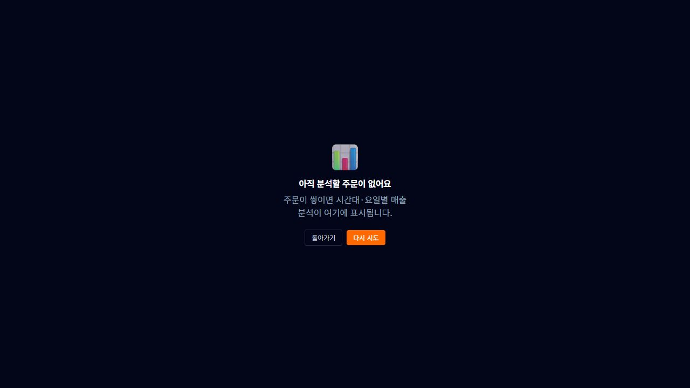
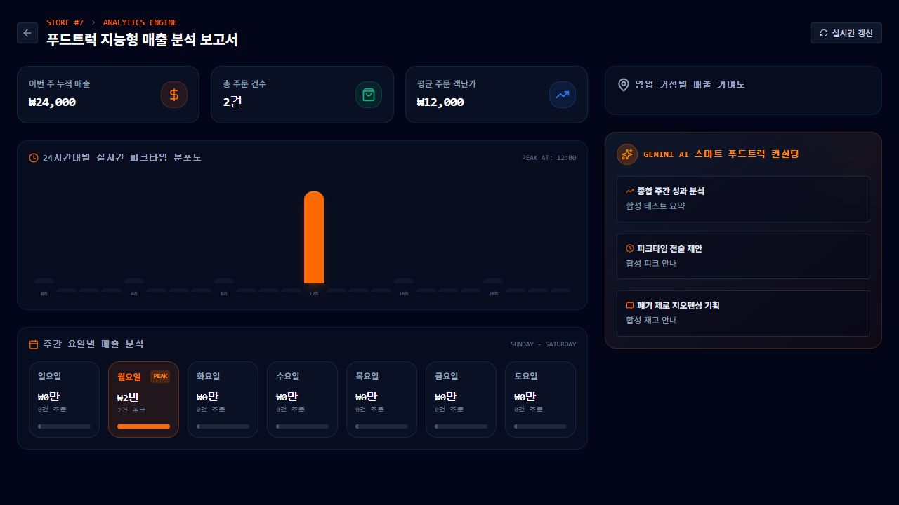

# FoodTruck 통계 실패·빈 데이터·재시도 검증

## 분리 범위

- 기준: main `080686f7baf26565d42ad3dbfa0ba6856f6be759`.
- PR #48의 독립 FoodTruck 수정 `4565b3c9`를 분리했다. 의존성·lockfile·백엔드·운영 설정 변경은 포함하지 않는다.
- API 실패 또는 잘못된 응답에서 표시하던 가상 매출 4,580,000원, 가상 주문 382건, 가상 영업 거점 및 상담 문구를 제거했다.
- 성공 응답의 유효한 0건은 빈 화면으로, 실패·잘못된 응답은 오류 화면으로 구분한다. 두 화면에서 재시도할 수 있다.
- 금액·주문 수·시간대/요일 배열·선택 거점/상담 정보의 형식을 검사한다. 갱신 실패 시 이전 수치를 지워 최신 통계로 오인하지 않게 한다.

## 화면 검증

실제 컴포넌트와 CSS를 사용하는 격리된 로컬 페이지에서 합성 API 응답을 주입했다. 외부 통신을 차단했으며 실제 FoodTruck API 또는 Gemini를 호출하지 않았다. 인증·권한을 포함한 전체 앱 E2E 및 운영 데이터의 정확성 검증은 이 화면 검증의 범위가 아니다.

| 시나리오 | 확인 결과 |
| --- | --- |
| API 거부 | 오류 안내와 돌아가기·다시 시도 버튼 표시, 가상 통계 없음 |
| 유효한 주문 0건 | ‘아직 분석할 주문이 없어요’ 안내 표시 |
| 오류 후 실제 버튼 재시도 | 합성 응답 24,000원·2건으로 복구 |
| 빈 화면 후 실제 버튼 재시도 | 새 합성 응답 24,000원·2건으로 복구 |

스타일 로딩 완료 후 1280×720 화면에서 저장한 증거:

## 안전 경계

- AI·유료 호출·매장 활성화 플래그와 운영 설정을 변경하지 않았다.
- `npm run ai:review:check`: OFF 전용 설정 일치, 5/5 통과. 모든 기능·매장 비활성화와 유료 호출 차단을 검사한다.
- 운영 배포·DB 변경·유료 API 호출·실제 고객정보 사용 없음.
- 기존 서버 집계 방식과 상담 생성 경로는 수정하지 않았다. API 성공 결과의 출처·품질 전반을 보증하는 변경은 아니다.

## 로컬 자동 검증

- `npx vitest run src/components/admin/FoodTruckAnalyticsDashboard.test.jsx --maxWorkers=1`: 15/15 통과. 실패·빈 응답·재시도·갱신 실패·잘못된 필드를 검사한다.
- 변경 컴포넌트와 테스트 파일 ESLint: 오류·경고 없음.
- `npm run build`: 통과. 기존 큰 청크 및 혼합 import 경고는 남아 있다.
- `git diff --check`: 통과.
