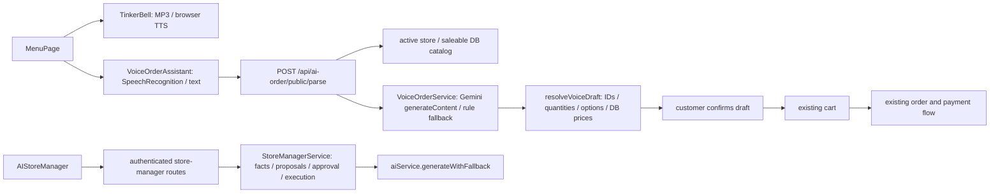

# WEMARKET AI 3.0 — Step 0 현행 감사

작성일: 2026-11-14 (한국시간). 기준: GitHub `kwpark0047/toss` 최신 `main` 조회 결과 `cb50a9280e34ff3862007279064795f361c0b32a`.
문서 전용 브랜치: `docs/ai3-gemini-live-audit`. 이 단계는 소스·의존성·공식 문서·DB 메타데이터 감사다. Live 엔진 구현/유료 호출/운영 배포/DB 쓰기를 수행한 단계가 아니다.

## 1. 결론과 우선순위

기존 Gemini 일반 생성 기능과 공개 음성 주문 초안, 팅커벨 MP3/TTS, 관리자 승인형 실행은 재사용 가능하다. Gemini Live 연결·PCM 스트리밍·단기 토큰·연결 재개·Live 도구 실행·서버 강제 예산 제한은 신규 구현 대상이다.

| 우선순위 | 대상 | 착수 조건 |
|---|---|---|
| P0 | Provider 계약, 인증/매장 격리, 서버 세션·비용 제한, PCM·연결 상태 | 모델/SDK 기능표, 예산 정합성, 차단·폴백 테스트 |
| P1 | 팅커벨 Live 어댑터 | 기존 캐릭터/다국어/MP3 자산 보존, 새 Live 기본 OFF |
| P1 | Voice Order Live 초안 | 기존 서버 검증 재사용, 고객 확인 후 장바구니, 기존 결제 화면 |
| P2 | 관리자 음성 상담·승인 실행 | 기존 소유자 승인 및 매장 범위 강제 |
| P3 | 카메라·메뉴 등록·마케팅 | 별도 동의·프레임 제한·초안 승인 |

## 2. 실제 호출 관계와 재사용 경계

| 실제 경로 | 확인한 동작 | 재사용 또는 제한 |
|---|---|---|
| `frontend/src/components/ai/TinkerBell.jsx:300,327` | 추천 조회, 한국어 MP3 우선·브라우저 TTS, 다국어 문구·캐릭터 | 디자인/자산 보존. 현재 응답 중 재생 취소는 Live barge-in 구현과 다름 |
| `frontend/src/utils/tinkerbell.js` | 서버 설정 변환, 추천 기본 OFF, 음성 안내·기존 음성 주문 기본 ON | 신규 Live opt-in을 기존 voice 설정과 분리. `aiModel: omniroute`는 Live 모델 설정으로 전용하지 않음 |
| `frontend/src/pages/MenuPage.jsx:286,830,920` | 매장 설정 조회, 음성 주문과 팅커벨 연결, 추천 동의 설정에 따른 storeId 전달 | 새 어댑터만 추가하고 기존 장바구니·가격 결정 경로 유지 |
| `frontend/src/components/menu/VoiceOrderAssistant.jsx:56,98,130` | 비연속 SpeechRecognition, 텍스트 분석, 초안 표시, 옵션·가격 재확인, 확인 버튼으로 반영 | 연속 대화/수정 명령/서버 draft revision은 신규. 현재 초안을 바로 주문 확정으로 사용하지 않음 |
| `frontend/src/api/aiOrder.js` → `routes/aiOrder.js` | 익명 QR 고객 공개 parse, IP당 분당 12회; `/parse`는 로그인 필요 | 공개 parse가 세션 인증·하드 예산 제한을 제공하는 것은 아님 |
| `controllers/aiOrderController.js:45,174` | 공개 parse는 500자·메뉴 최대 300개, 활성 매장·판매 가능 상품 조회, 12종·수량 1~20, 필수 옵션/가격 검증 | `resolveVoiceDraft`를 순수 서비스로 추출하고 기존 HTTP 경로도 동일 함수를 호출하도록 회귀 검증 |
| `services/VoiceOrderService.js:1,17,66` | 구 SDK `generateContent`, 단일 문장 JSON 추출, 오류/키 없음 시 규칙 파서 | 가격·권한 판정자가 아닌 초안 추출기. 기존 규칙 파서를 폴백으로 유지 |
| `services/aiService.js:24,34` | 일반 생성·번역·이미지·추천, 모델 순차 폴백·메모리 캐시 | Live와 분리 유지. 일반 생성 모델을 Live 모델로 가정하지 않음 |
| `frontend/src/components/admin/AIStoreManager.jsx` → `frontend/src/api/storeManager.js` | briefing/chat/actions/evaluation | 기존 사업자 화면에 후속 음성 입력 어댑터 추가 |
| `routes/storeManager.js:31` | 로그인 후 매장 역할 확인; owner/manager/super_admin 조회, 소유자만 실행 | Live 관리자 도구도 이 정책과 서버 서비스 재사용. 클라이언트 전달 role/storeId 신뢰 금지 |
| `services/StoreManagerService.js` | 실제 집계 기반 제안, dedupe·행 잠금·승인/실행/중단·감사 이벤트, Gemini 설명·하루 5회 예약 | 현재 무할인 노출/시간대 제안 중심. 임의 할인 캠페인/7개 전문 에이전트가 완성된 것으로 간주하지 않음 |
| `app.mts:344,367,371` | `/api/ai`, `/api/store-manager`, `/api/ai-order` 실제 마운트 | AGENTS의 구 `app.js`·구 운영 URL 설명보다 현재 진입점과 `config/deployment-targets.json` 우선 |

관리자 임의 작업을 모델 함수 이름에 바로 연결하지 않는다. 기존 주문·결제·환불·정산은 변경하지 않는다. 최초 고객 도구는 메뉴 조회·검증된 초안 생성까지만 허용하며 장바구니 적용은 고객의 UI 확인을 거친다.

## 3. 의존성·모델·환경 설정

- 현재 루트 의존성은 `@google/generative-ai: ^0.24.1`; `@google/genai`는 루트·프런트 manifest에 없다. 실제 검색에서 `live.connect`, `authTokens`, `sessionResumption`, `AudioWorklet` Live 구현도 찾지 못했다.
- 기존 모델: `aiService.models`의 `gemini-3.5-flash`, `gemini-3-flash-preview`, `gemini-flash-latest`; VoiceOrderService는 `gemini-3.5-flash` 고정이다. 계정별 모델 가용성·지원 종료 여부는 실제 인증 모델 목록과 제한된 canary로 추가 확인해야 한다. 코드에 존재한다는 사실만으로 지원/정상 응답을 판정하지 않았다.
- 공식 문서는 신규 `@google/genai`를 권장하며 구 SDK는 Live를 제공하지 않는다. 조회 시 npm 최신 버전은 `3.3.0`, Node 요구사항 `>=22.0.0`; 저장소 Node `>=22.22.0`과 범위가 맞는다. 실제 설치·lockfile 변경·번들 호환성 검증은 Phase 1 작업이다.
- 기존 `ws`, Redis 클라이언트와 Socket.io는 존재하지만 Live 연결 수명/오디오 프레임/Provider 사용량 프로토콜은 별도 구현이 필요하다.
- `.env.example`에는 일반 `GEMINI_API_KEY`만 확인됐다. 신규 Live 모델, 기능 flag, 요금표 버전, 세션/유휴/동시성/금액 제한 설정이 필요하다. 브라우저 `VITE_*`에 영구 키를 추가하지 않는다.

## 4. 권한·동의·비용 관련 관찰

1. 고객 공개 메뉴 조회 권한과 사업자 통계·변경 권한은 분리해야 한다. 익명 QR 고객은 아직 주문 전이므로 기존 주문 capability 발급을 강제하면 연결할 수 없다. 별도 매장 범위·짧은 수명의 익명 Live 세션 권한을 설계해야 한다.
2. `customer_ai_consents`는 기존 고객 식별·개인화 동의 모델이다. 마이크/카메라 브라우저 권한, 음성 처리 동의, 기록 보존 정책을 대신하지 않는다. 신규 로그는 기본적으로 원본 음성·영상·전문을 저장하지 않는다.
3. `aiService.generateWithFallback`는 사용량을 사후 fire-and-forget으로 기록하고 `storeId` 기본값이 null이다. VoiceOrderService는 이를 직접 경유하지 않는다. `AIUsageRepository`는 기록 실패를 삼킨다. 기존 로그는 관측용이며 예산 승인 원장으로 사용할 수 없다.
4. 기존 로그는 토큰 합계·costUsd 슬롯은 있으나 모달리티·세션·요금 버전·예약 잔액 구조가 없다. 현재 generateWithFallback는 costUsd를 계산해 전달하지 않는다. 관리자 하루 5회 제한 역시 모든 Live 비용 상한과 다르다.
5. 단기 토큰은 영구 키 노출 위험을 낮추지만, 브라우저가 오디오를 Google로 직접 보내면 WEMARKET 서버는 신뢰할 수 있는 실시간 사용량·중단을 강제하기 어렵다. 따라서 엄격한 비용 제한을 요구하는 P0는 서버 중계·서버 계량 우선으로 제안한다. 직접 연결은 제한을 별도로 검증한 선택 모드로 남긴다.

## 5. DB·마이그레이션 읽기 전용 확인

대상은 연결된 `kdisbvhofkyoijnawszp` 프로젝트. 고객 행이나 대화 내용 대신 `information_schema.columns`, `_prisma_migrations`만 조회했다.

| 영역 | 현행 Prisma 및 실제 DB | 판정 |
|---|---|---|
| `store_tinkerbell_settings` | enabled/lang/voice/large_font/custom_msg/ai_recommendation/voice_order_enabled | 확인 범위 일치; 추천 기본 false |
| `ai_usage_logs` | camelCase Prisma 필드의 snake_case `@map` 포함 실제 컬럼 대조 | 확인 범위 일치; Live 정산 원장 확장은 필요 |
| `customer_ai_consents` | store/user/verified_phone/verified_at/consent_at/revoked_at | 기존 동의 재사용 범위 분리 필요 |
| `manager_actions`, `manager_action_events`, `manager_ai_requests` | 제안 상태·매장·승인자·행위자·일일 요청 예약 | 기존 승인 모델 보존 |
| 신규 Live 세션·설정 | 제안한 `ai_live_sessions`, `ai_store_configs` 테이블은 조회 결과 없음 | 후보 이름일 뿐, 중복 생성 전 전체 데이터 모델 설계 필요 |

다음 4개 migration은 finished=true, rolled_back=false이며 DB checksum과 `git show origin/main:.../migration.sql` 원본 SHA-256이 모두 일치했다:

- `20260923033303_add_ai_usage_logs`
- `20261007030000_ai_store_manager`
- `20261022010000_store_tinkerbell_settings`
- `20261025010000_tinkerbell_settings_rls`

이는 지정 영역의 확인이며 전체 DB drift 검사·RLS 검증·모든 인덱스/FK 검증 완료를 의미하지 않는다. 운영 migration, `db push`, 데이터 수정은 수행하지 않았다. 신규 모델은 기존 manager 승인 모델·usage 모델과 책임을 비교한 뒤 확정한다.

## 6. 공식 Live 제약을 반영한 설계 기준

확인일 기준 공식 문서 내용이며 모델·지역·계정 가용성을 구현 착수 시 다시 확인한다.

- 오디오는 16-bit little-endian PCM, 입력 16kHz 기준·출력 24kHz. 브라우저 실제 장치 sample rate를 측정하고 리샘플링한다.
- 압축 없는 세션은 오디오 15분, 오디오/영상 2분 제한이 안내돼 있다. 연결 자체의 약 10분 수명과 구분하고 GoAway·재개 핸들·컨텍스트 압축을 처리한다. 앱은 주문을 짧게 제한한다.
- 영상은 이미지 프레임 형태이며 최대 1fps. 제품에서는 JPEG만 허용하고 프레임/바이트/해상도 제한을 서버에서 적용한다. 카메라는 P3·명시적 동의 이후다.
- Function Calling은 모델별 지원표를 사용한다. 예를 들어 현재 문서의 3.1 Flash Live는 동기만, 3.8 Live는 동기/비동기, Extended Thinking은 비동기만이다. P0 주문 도구에는 동기 호출 가능한 모델만 허용하고 미지원 NON_BLOCKING 옵션을 보내지 않는다.
- `toolCallCancellation`의 call ID를 실행 취소 신호로 처리한다. 취소 전 이미 커밋된 작업을 성공하지 않은 것으로 숨기지 않는다. 고객 P0에서 금전 변경 도구를 제외해 이 위험을 줄인다.
- 단기 토큰은 Live 전용, 1회 사용·짧은 시작 유효시간·모델/설정 제약을 적용한다. 토큰은 탈취 가능하므로 로그인/익명 세션 검증과 서버 도구 권한 검증을 대체하지 않는다.
- 주기적인 `usageMetadata`와 모달리티 사용량을 수집한다. 문맥·재연결·도구 재전송이 비용에 미치는 영향을 측정하고 단순 분당 금액만으로 정산하지 않는다. 클라이언트 계량은 참고값이다.

출처:

- [공식 SDK](https://ai.google.dev/gemini-api/docs/libraries)
- [Live 기능·오디오·영상](https://ai.google.dev/gemini-api/docs/live-guide)
- [세션 관리](https://aistudio.google.com/docs/live-api/session-management)
- [단기 토큰](https://ai.google.dev/gemini-api/docs/ephemeral-tokens)
- [도구 지원](https://ai.google.dev/gemini-api/docs/live-tools)
- [Live 프로토콜·취소](https://aistudio.google.com/api-reference/live)
- [공식 가격표](https://ai.google.dev/gemini-api/docs/pricing)

## 7. 실제 실행한 회귀 검증

| 검증 | 결과 | 한계 |
|---|---|---|
| Jest: VoiceOrderService, aiService, aiController, tinkerbellSettings, aiPersonalization.security | 5 suites / 28 tests PASS | Gemini 외부 응답은 mock/규칙 파서; 실제 음성 품질 검증 아님 |
| Vitest: VoiceOrderAssistant, tinkerbellWeather | 2 files / 9 tests PASS | DOM 기반, 모바일 실기기 음성 아님 |
| Node: `tests/saas/store-manager.test.cjs` | 5 tests PASS | mock/로컬 HTTP 권한 경로, 실제 사업자 계정 동작 확인 아님 |
| 관련 migration·DB 컬럼 | 위 범위 읽기 전용 대조 PASS | 전체 스키마 drift 판정 아님 |

관리자 테스트 최초 실행은 샌드박스의 localhost 포트 EACCES로 1건 실패했으나, 로컬 테스트 접근을 허용한 재실행에서 5건 모두 통과했다. 제품 코드 수정으로 우회하지 않았다.

이번 변경은 문서만 추가했다. 기존 결제/환불 통합 테스트 전체, 실제 Gemini Live 비용·지연·음질, Android/iPhone 마이크·끼어들기·백그라운드 동작은 미검증이다. 사용자 결제와 유료 Live 호출을 발생시키지 않았다.

## 8. Phase 1 인계

상세 순서와 통과 기준은 [01-GEMINI-LIVE-ARCHITECTURE.md](01-GEMINI-LIVE-ARCHITECTURE.md)에 기록했다. 먼저 기본 OFF 설정·권한·서버 예산 원장·Provider 테스트 계약을 구현한 뒤 PCM과 실제 모델 연결을 연결한다. 원격 DB migration 및 운영 활성화는 검토 가능한 변경물과 복구 절차를 준비한 뒤 별도 명시적 승인을 받는다.

이번 완료 범위는 Step 0 감사와 Phase 1 설계다. P1~P3, 나머지 최종 문서, 기능 구현 완료를 주장하지 않는다.
