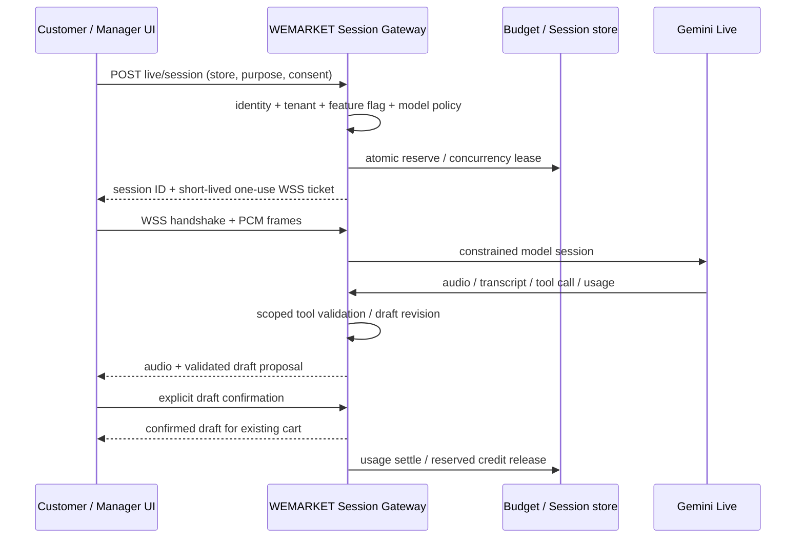

# Gemini Live Phase 1 — P0 상세 구현안

2026-11-14 설계 초안. 구현 전 문서이며 배포·DB 변경 승인 요청은 아니다. 현행 근거는 [Step 0 감사](00-CURRENT-STATE-AUDIT.md) 참조.

## 1. 경계와 연결 방식

Provider 인터페이스 `connect / sendAudio / sendText / sendImage / sendToolResult / resume / close`와 이벤트 `state / audio / transcript / toolCall / toolCancel / usage / goAway / error`를 정의한다. 기본 구현은 Gemini Live 하나이며 OpenAI 연결·키·유료 호출은 추가하지 않는다.

기본 경로는 브라우저 → WEMARKET WSS 중계 → Gemini Live다. Render의 기존 Node 진입점에 upgrade 경로를 추가하고 기존 Socket.io 연결·고객 주문 채널을 보존한다. HTTP 서버 실제 생성 위치와 종료 훅을 구현 시 다시 확인한다.

WSS ticket은 WEMARKET 중계 서버에만 통하는 짧은 수명의 권한이다. Gemini 단기 토큰과 이름·용도를 구분한다. query에 키를 넣지 않고, HTTP access log·오류·분석 SDK에 ticket/토큰이 남지 않도록 한다. 브라우저 WebSocket의 헤더 제약을 고려해 허용 Origin 검사와 일회용 ticket 전달 방식(subprotocol 또는 인증 첫 프레임)을 확정한다. 인증 전 오디오 프레임은 수락하지 않는다.

직접 연결 모드는 서버가 Gemini 단기 토큰을 발급해 메모리에서만 사용한다. `uses=1`, model/config 제약과 시작/세션 만료를 잠근다. 하지만 클라이언트가 usage 보고를 누락하거나 중단 명령을 무시할 수 있으므로, 서버 강제 상한이 검증되기 전에는 운영 예산 보장 모드로 활성화하지 않는다. 직접 연결 실패 시 중계 연결 전 기존 연결을 먼저 종료하고 세션 중복·이중 비용을 방지한다.

## 2. 권한과 도구

| purpose | 세션 발급 | 허용 도구 | 금지/승인 경계 |
|---|---|---|---|
| customer | 활성 매장·Live opt-in·동의·익명 store-bound capability·발급 제한 | 판매 가능 메뉴/옵션 조회, 검증된 주문 초안 | 매출/고객정보/임의 SQL/결제·환불·운영 변경 금지 |
| manager | 기존 로그인 세션·실제 매장 owner/manager 역할 | 매출/재고/예약 집계·제안 초안 | 소유자 승인 없는 실행 금지, 기존 transition 서비스 재사용 |

모델 인자의 storeId는 사용하지 않고 서버 세션의 storeId로 고정한다. `toolName` allowlist, 스키마, payload 바이트 제한, 호출 횟수, 실행 상태를 검증한다. 호출 키는 `(liveSessionId, toolCallId)`로 멱등 처리하고 재연결 후에도 보존한다. 관리자 승인 토큰은 actionId·payload hash·매장·권한 주체·만료와 연결한다.

고객 초안은 기존 `resolveVoiceDraft`를 서비스로 추출하고 생성/수정마다 최신 DB 가격·품절·옵션을 재검증한다. draft revision과 확인 nonce를 사용하며 늦게 도착한 응답이 최신 장바구니를 덮지 못하게 한다. 장바구니 적용도 draft ID/revision별 한 번만 수행한다. 주문 생성과 결제는 기존 UI·서버 흐름으로만 진행한다.

도구 상태는 `pending → running → completed / failed / cancelled`로 기록한다. 같은 call ID의 반복은 이전 결과를 반환한다. 취소는 시작 전 차단, 실행 중 AbortSignal, 커밋 직전 상태 재검증으로 처리한다. 커밋 후 취소는 실제 상태를 반환하고 별도 승인 없는 환불/역변경을 하지 않는다. 동기 호출 가능한 모델을 주문용 허용 목록에 넣고 순차 검증한다. 비동기 전용 모델은 P0 주문 목적에서 차단한다.

## 3. 비용·시간·동시성

신규 Live는 전역 flag와 매장별 설정 모두 기본 OFF다. 기존 팅커벨 음성/추천 설정을 자동으로 Live 동의로 간주하지 않는다. 매장별 일일 시간·월 비용·동시 세션·1회 최대 시간·유휴 timeout을 서버 정책으로 관리한다.

- 세션 시작 전 최악 조건의 사용량을 보수적으로 예약하고 `spent + reserved + newReservation <= limit`을 원자적으로 검증한다. 금액은 정수 micro-USD 등으로 관리해 Float 누적 오차를 피한다.
- 새 `AILiveSession`, 예약/사용량 이벤트, 도구 실행 모델을 기존 ai_usage_logs와 분리하거나 명시적으로 확장한다. 기존 manager_actions/events는 재사용하고 AIActionApproval을 무조건 중복 생성하지 않는다.
- Redis lease/동시성 카운터와 PostgreSQL 원장의 역할을 명시한다. 여러 인스턴스에서 중복 예약·정산이 없어야 한다. 저장소 장애 시 신규 유료 세션은 거부하고 기존 일반 음성 주문으로 폴백한다.
- 서버가 수신한 usage 이벤트를 모달리티·세션·연결 세대·요금 버전과 연결한다. 누적/증분 의미는 고정한 SDK/모델 프로토콜에 맞춰 검증하고 누적값을 매 이벤트마다 다시 합산하지 않는다.
- 재연결은 같은 앱 세션·예산 예약에 귀속하되 새 Provider 연결 비용은 빠짐없이 포함한다. 누락 usage는 0원으로 확정하지 않고 예약을 유지해 정산 대기로 분류한다.
- 사용량 단위·텍스트/오디오/영상 입출력 단가·컨텍스트 재처리는 버전 있는 요금 설정으로 계산한다. 가격표/모델/통화 설정이 없으면 신규 세션을 차단한다. 추정 비용과 Provider 청구 대조값은 구분한다.
- 최대 입력 바이트/오디오 시간/출력 토큰/영상 프레임을 제한하고 출력 큐 상한·느린 소비자 backpressure를 둔다. Provider 계량 지연·in-flight 출력 때문에 청구가 순간 한도와 정확히 일치한다고 보장하지 않는다. 안전 마진과 계정 수준 Google 예산 제한을 함께 검증한다.

## 4. 미디어와 연결 수명

- 마이크는 사용자 제스처·동의 후 획득. AudioWorklet 기반 mono PCM16 LE 16kHz 변환과 실제 장치 sample rate 리샘플링을 테스트한다. 웹캠은 P0에서 비활성이다.
- 출력은 24kHz PCM 스트림을 순서대로 재생한다. interrupted 이벤트에서 예약된 AudioBufferSource와 큐를 즉시 정리하고 새 응답과 섞이지 않게 한다.
- 상태는 IDLE/CONNECTING/LISTENING/THINKING/SPEAKING/TOOL_CALLING/INTERRUPTED/ERROR/FALLBACK을 공통 이벤트로 UI에 전달한다. 모델별 복수 parts를 모두 처리한다.
- 마운트/버튼 중복 클릭/StrictMode 재실행에 세션 하나만 유지한다. 종료 시 socket·tracks·AudioContext·timer·listener·lease를 정리한다. 탭 종료 알림만 의존하지 않고 서버 lease/idle timeout으로 회수한다.
- 연결 세대 번호로 오래된 audio/tool 응답을 폐기한다. GoAway 전 resume 시도, 지수 backoff·jitter·최대 재시도·사용자 중지 우선순위를 둔다. 컨텍스트 압축은 대화 편의용이며 검증된 장바구니·권한·승인 상태를 요약 텍스트에 의존시키지 않는다.
- P3 영상은 JPEG 프레임 최대 1fps 이하이며 실제 모델의 해상도·바이트 제한을 다시 확인한다. 지연된 영상은 쌓지 않고 최신 프레임만 유지한다.

## 5. API·파일 후보

다음은 미구현 제안이며 현재 제공 API로 표시하지 않는다.

- `POST /api/ai/live/session`: 목적·매장·동의·멱등 키 검증, 예산 예약, sessionId와 일회 ticket 발급.
- `WSS /api/ai/live/connect`: 인증 handshake, PCM·전사·모델 이벤트·도구 스트림.
- `POST /api/ai/live/sessions/:id/close`: 소유 세션 종료 및 중복 안전 정산.
- `GET /api/ai/live/usage`: 관리자 매장 권한 후 조회. 고객에게 다른 세션 사용량 공개 금지.
- `GET/PATCH /api/admin/stores/:id/ai-config`: 기존 관리자 settings 권한과 유료 opt-in 확인.
- Provider 중계에서는 도구 요청/응답을 서버가 처리한다. 브라우저 tool-response API를 추가할 경우 서버에 등록된 pending call ID만 수락하고 전달된 실행 결과를 신뢰하지 않는다.
- `services/ai/live/{GeminiLiveProvider,LiveSessionService,ToolRegistry,BudgetService}`, `routes/aiLive.js`, `frontend/src/hooks/useAILiveSession`, `frontend/src/utils/liveAudio`, `config/aiLiveModels`, 버전별 요금 설정을 후보로 둔다.

## 6. 구현 순서·통과 기준·롤백

| 순서 | 구현 묶음 | 필수 검증 | 롤백 |
|---|---|---|---|
| P0.1 | 신규 SDK 버전 고정·Provider fake·모델 capability 설정·기본 OFF | 구 SDK 병존·Node22·기존 생성 API 회귀; 미지원 모델 차단 | 신규 import/flag 비활성 |
| P0.2 | 세션 권한·매장·익명/관리자 분리·Origin·발급 제한 | 무권한/다른 매장/만료/재사용 ticket 거부, 모든 신규 유료 호출 전 검증 | 새 경로 off, 기존 음성 보존 |
| P0.3 | 세션·예약 원장·TTL/lease·정산·요금 버전 | 실제 로컬 PostgreSQL/Redis 동시성, 재시도·crash·누락 usage·저장소 장애 | flag off, 원장 보존·예약 정산, 역파괴 migration 금지 |
| P0.4 | PCM 입력·재생·순서·interrupt·정리 | 44.1/48kHz 리샘플, 출력24kHz, 큐 상한, unmount/재시도 | 기존 SpeechRecognition/MP3/TTS |
| P0.5 | 고객 도구·기존 draft 검증 추출·취소·멱등성 | 상품/수량/옵션/가격 위조·품절·중복·취소·stale revision 차단 | 새 도구 off, 기존 parse HTTP 유지 |
| P0.6 | GoAway·재개·압축·사용량 | 끊김·종료·동일 세션 재개·중복 호출·비용 누적 fixture | 제한 재시도 후 일반 모드 |
| P0.7 | 제한된 실제 모델 canary와 staging UI | 동의한 합성 음성·작은 예산, 지연/usage/비용 대조; Android Chrome/iPhone Safari | 즉시 flag off·Provider 세션 종료 |

P0.3의 DB migration은 로컬/별도 staging에서 먼저 검증한다. 운영 적용 전 백업·마이그레이션 체크섬·복구 절차·변경 목록을 제출하고 명시적 승인을 받는다. 운영 배포·실제 유료 canary는 이번 Step 0 범위에 포함되지 않는다.

## 7. 주요 위험과 중단 기준

모델 preview 변경, 계정 가용성, 모바일 마이크·자동재생, 오디오/토큰 계량 지연, 익명 API 남용, 재연결 중 도구 중복, 공유 Redis/DB 장애가 우선 위험이다. SDK mock만 통과한 상태에서 상용 음성 품질·하드 비용 상한·모바일 실기기 성공을 선언하지 않는다. 익명 고객에서 관리자 도구가 노출되거나 서버 차단 후 비용이 계속 증가하면 활성화를 중단한다.

Step 0 이후에는 위 순서로 P0 구현을 진행하며 P1 UI 통합은 P0 보안·예산·폴백 통과 후 시작한다.
